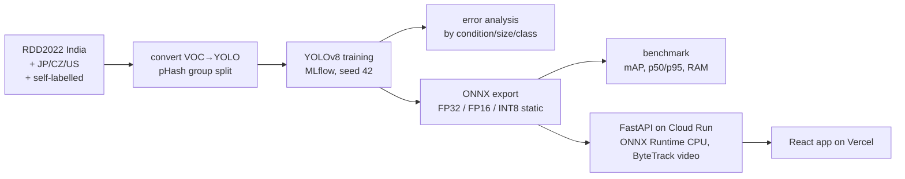
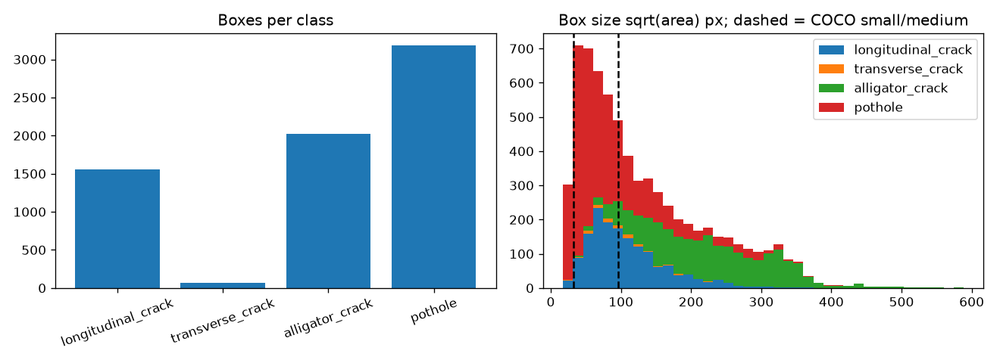

# RoadSense

Detects potholes and three crack types in Indian dashcam images and video, and runs in real time on a CPU (INT8 ONNX).

**Live demo:** _TBD (Phase 8 deploy)_ ·  _(GIF placeholder)_

## Architecture


## Dataset

**Source:** [RDD2022](https://figshare.com/articles/dataset/RDD2022_-_The_multi-national_Road_Damage_Dataset_released_through_CRDDC_2022/21431547), the multi-national Road Damage Dataset released through CRDDC'2022.
**License:** CC BY 4.0, per the figshare metadata. Cite Arya et al., *RDD2022: A multi-national image dataset for automatic Road Damage Detection*, arXiv:2209.08538.

The RDD2022 test splits have no public labels, so train, val and test are all carved from the labelled `train` folders.

### Class mapping

| RDD code | id | Class |
|---|---|---|
| D00 | 0 | longitudinal_crack |
| D10 | 1 | transverse_crack |
| D20 | 2 | alligator_crack |
| D40 | 3 | pothole |

Dropped labels in India: D44 (1062), D01 (179), D43 (57), D11 (45), D50 (28). These are joint cracks, crosswalk/white-line blur and manholes, which fall outside the 4-class scope. One `D0w0` label is a typo for D00 and is mapped to it. Source: `python -m src.data.convert`.

### India subset stats (`results/dataset_stats.json`)

| | longitudinal | transverse | alligator | pothole |
|---|---|---|---|---|
| Images | 1109 | 60 | 1758 | 1530 |
| Boxes | 1555 | 68 | 2021 | 3187 |

- 7706 labelled images, all 720×720. Of these, 4483 have no damage.
- Box sizes (COCO buckets): 310 small, 2864 medium, 3657 large.
- Imbalance (max/min boxes): 46.9×. **Transverse cracks are nearly absent in India**, so other countries are needed for that class (Phase 3).



### Splits (`results/split_report.json`)

- **Negatives** are capped at 10% of the split set, which keeps 358 of 4483. This gives 3581 images.
- **Leakage control:** RDD2022 has no video or sequence ids, and its filenames are shuffled. So images are grouped by perceptual hash over *all pairs*: Hamming distance ≤ 8 means same group.
  - At distance 2 we found the same location a few seconds apart, split across sets. Threshold 8 gives a largest group of 72 images. Threshold 10 chains into one 574-image blob.
- **Stratification:** whole groups are stratified by their rarest class, seed 42.
- **Check:** after splitting, the minimum pHash distance between any two splits is **10**.

| Split | Images | Negatives | longitudinal | transverse | alligator | pothole |
|---|---|---|---|---|---|---|
| train | 2506 | 245 | 1093 | 47 | 1419 | 2257 |
| val | 540 | 61 | 215 | 11 | 313 | 429 |
| test | 536 | 52 | 248 | 10 | 289 | 501 |

### Demo media
Sample images: 5 RDD2022 India test-split images (CC BY 4.0). Sample video: [Pexels 34991422](https://www.pexels.com/video/scenic-drive-on-indian-highway-under-blue-skies-34991422/) (Pexels License), trimmed to 28 s and downscaled to 720p H.264.

### Self-labelled in-the-wild set
See [docs/labeling.md](docs/labeling.md). Each whole video goes to either train (about 30%) or `wild_test` (about 70%).

## Experiments (Phase 3)

One variable changed per run against the baseline (YOLOv8n, 640px, Ultralytics defaults, 50 epochs, seed 42). All rows are on the India test split (536 images). Source: `results/<run>.json`.

<!-- BEGIN:experiments -->
| Run | Change | mAP@50 | mAP@50-95 | AP50 D00 | AP50 D10 | AP50 D20 | AP50 D40 | Train min |
|---|---|---|---|---|---|---|---|---|
| baseline | Phase 2 baseline: YOLOv8n, 640px, Ultralytics defaults except epochs | 0.342 | 0.140 | 0.279 | 0.036 | 0.605 | 0.448 | 188.5 |
| exp_v8s | Exp 1 model size: v8s vs baseline v8n | 0.360 | 0.148 | 0.352 | 0.004 | 0.621 | 0.463 | 54.5 |
| exp_960 | Exp 2 image size: 960 vs 640 (thin cracks). Source images are 720px, so 960 upsamples. | 0.326 | 0.132 | 0.286 | 0.026 | 0.572 | 0.420 | 75.7 |
| exp_aug | Exp 3 augmentations: road-specific albumentations + darker HSV | 0.322 | 0.137 | 0.272 | 0.023 | 0.600 | 0.394 | 103.4 |
| exp_rfs | Exp 4 class imbalance: repeat-factor oversampling of minority classes | 0.339 | 0.142 | 0.294 | 0.005 | 0.624 | 0.434 | 31.8 |
<!-- END:experiments -->

## Error analysis (Phase 4)

<!-- BEGIN:errors -->
**exp_v8s_int8head** on `data\splits\test.txt` (from `results\error_analysis_exp_v8s_int8head.json`)

| Slice | Images | mAP@50 | mAP@50-95 |
|---|---|---|---|
| overall | 536 | 0.336 | 0.134 |
| lighting: bright | 487 | 0.345 | 0.140 |
| lighting: dim | 49 | 0.344 | 0.128 |
| box_size: small | 536 | 0.124 | 0.036 |
| box_size: medium | 536 | 0.188 | 0.074 |
| box_size: large | 536 | 0.318 | 0.135 |

Top false positives @0.25: pothole:localisation (104), longitudinal_crack:localisation (79), alligator_crack:localisation (69), pothole:background (56), longitudinal_crack:background (38)

False negatives @0.25: pothole (296), longitudinal_crack (157), alligator_crack (128), transverse_crack (10)

<!-- END:errors -->

Failure gallery: `results/failures/<run>/` (white box = missed ground truth, "FP" = false positive).

## Benchmark (Phase 5)

<!-- BEGIN:benchmark -->
CPU: AMD64 Family 25 Model 117 Stepping 2, AuthenticAMD (16 threads), batch 1, 536 test images, imgsz 640

| Format | mAP@50 | mAP@50-95 | Δ mAP@50 | p50 ms | p95 ms | FPS | Size MB | Peak RAM MB |
|---|---|---|---|---|---|---|---|---|
| PyTorch FP32 | 0.355 | 0.145 | -0.000 | 67.8 | 81.0 | 14.2 | 22.5 | 899 |
| ONNX fp16 | 0.354 | 0.144 | -0.000 | 70.6 | 79.7 | 14.1 | 22.4 | 273 |
| ONNX fp32 | 0.354 | 0.144 | -0.001 | 65.7 | 74.1 | 15.2 | 44.8 | 236 |
| ONNX int8 | 0.000 | 0.000 | -0.355 | 27.3 | 35.3 | 35.6 | 11.6 | 137 |
| ONNX int8_head | 0.336 | 0.134 | -0.019 | 41.1 | 50.2 | 23.8 | 18.0 | 152 |
<!-- END:benchmark -->

_Latencies were measured while GPU training ran on the same laptop, so they are inflated; to be re-run on an idle machine._

Raspberry Pi instructions: [docs/deploy.md](docs/deploy.md#3-raspberry-pi-45-benchmark).

## Key decisions and trade-offs

- **Leak-safe split by near-duplicate groups.** RDD India filenames are shuffled, so consecutive dashcam frames are not adjacent. Images are grouped by global pHash (union-find, Hamming <= 8) and whole groups go to one split. Minimum pHash distance between any two splits is 10 (`results/split_report.json`).
- **Shipped model: YOLOv8s, ONNX INT8 with the Detect head left in FP32** (`models/model_int8_head.onnx`). v8s was the best run (test mAP@50 0.360). On CPU it keeps mAP@50 0.336 vs 0.354 for ONNX FP32 and is about 1.6x faster (41.1 vs 65.7 ms p50).
- **Why the head stays FP32.** Full static INT8 gives mAP 0. The Detect output concatenates box coordinates (0-640) with class scores (0-1); one INT8 scale for that tensor wipes out the scores. Excluding `/model.22/` from quantisation fixes it.
- **Serving has no PyTorch.** ONNX Runtime + OpenCV only; own letterbox and NMS, checked to match Ultralytics output. Docker image 959 MB.
- **Video counts are per track, not per frame.** ByteTrack, majority-vote class per track, a track counts only if seen in >= 3 frames.
- **Single seed (42).** Differences of about 0.02 mAP between runs may be noise; read the table as directional.

## What didn't work / next

- **960 px input** (0.326 vs 0.342 baseline). Source images are 720 px, so 960 only upsamples.
- **Road augmentations** (motion blur, rain, fog, darker brightness, JPEG): 0.322. The India test set has no night or rain frames (darkest mean V = 68), so the test cannot reward robustness to them. Training also crashed twice on RAM and was resumed from `last.pt`, so its train time is not comparable.
- **Repeat-factor oversampling**: 0.339, no gain. Transverse crack has only 68 boxes in the whole India set and 10 in test, so its AP (0.004-0.036) is noise in every run.
- **Per-class confidence thresholds tuned on val** (`results/threshold_exp_v8s_int8head.json`): no test gain. Pothole's best threshold is the default 0.25; longitudinal crack moves to 0.15 and test F1 drops 0.379 -> 0.358. Missed potholes (296 of 501 at 0.25) are a model limit, not a threshold one.
- **Baseline train time (188.5 min) is inflated** by other CPU load at the time; v8s took 54.5 min.
- **Next:** multi-country training (`exp_multi`, adds 7,673 transverse and 11,787 longitudinal boxes from Japan/Czech/US; running), labelled in-the-wild Indian dashcam set ([docs/labeling.md](docs/labeling.md)), Raspberry Pi benchmark, Cloud Run deploy ([docs/deploy.md](docs/deploy.md)).

## Reproduce (data)

```
uv venv -p 3.11 && uv pip install -e ".[dev]"
python -m src.data.download --countries India      # 527 MB, range-reads one country from the 13 GB archive
python -m src.data.convert --countries India
python -m src.data.stats
python -m src.data.split                            # writes configs/rdd_india.yaml
```
